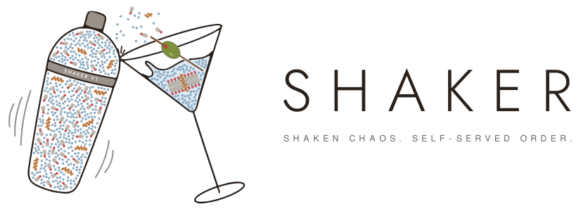
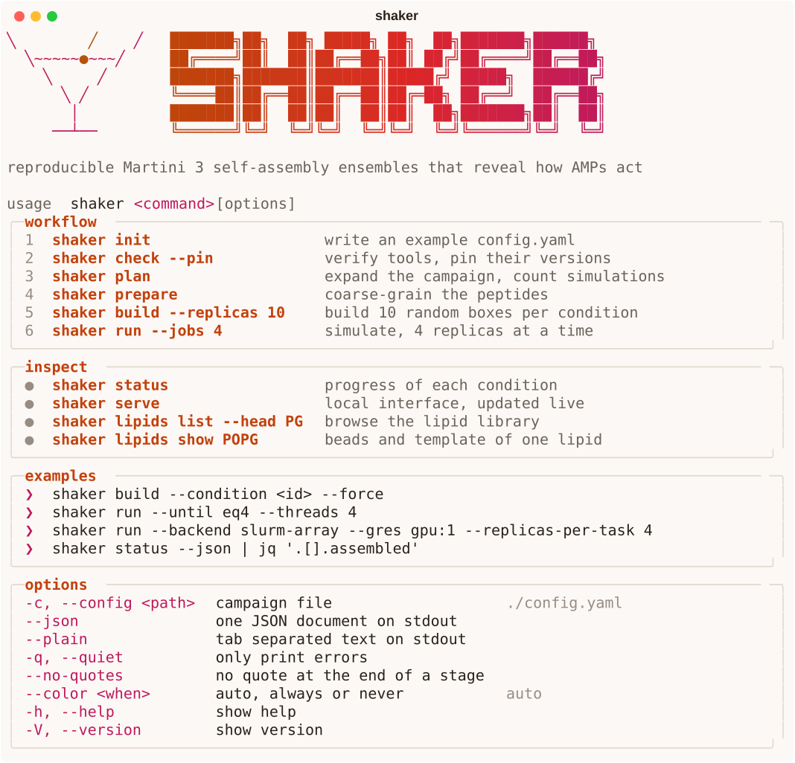
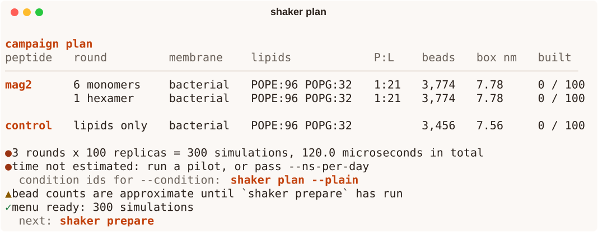
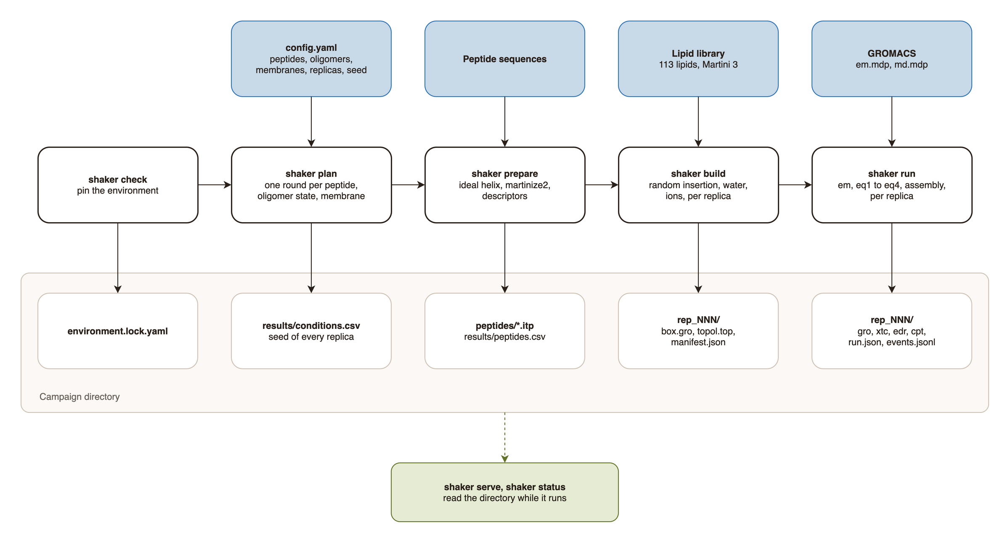

<p align="center">
  <picture>
    <source media="(prefers-color-scheme: dark)" srcset="assets/logo/logo-dark.svg">
    
  </picture>
</p>

Shaken chaos. Self-served order.

**SHAKER** (Stochastic High-throughput Assembly Kit for Ensemble Replicas) builds randomly mixed boxes of water, ions, lipids and helical antimicrobial peptides (AMPs) and simulates their self-assembly with Martini 3 in GROMACS. Every box comes from a seed, every condition gets many replicas, and the distribution of outcomes across replicas is the result.

<p align="center">
  
</p>

## Contents

| Section | Content |
|---|---|
| [Quick start](#quick-start) | install and the six commands of a campaign |
| [Pipeline](#pipeline) | stages and what each one writes |
| [Commands](#commands) | every command and its flags |
| [Configuration](#configuration) | keys of `config.yaml` |
| [Campaign directory](#campaign-directory) | files on disk |
| [Box construction](#box-construction) | how a random box is made |
| [Simulation stages](#simulation-stages) | minimization, ramp, self-assembly |
| [Lipid library](#lipid-library) | the 113 bundled lipids |
| [Output contract](#output-contract) | streams, JSON, exit codes |
| [Measured](#measured) | speed and file sizes |
| [Status](#status) | what is implemented |
| [Good to know](docs/GOOD_TO_KNOW.md) | peptides, membranes, reading the results |

## Quick start

| Requirement | Version tested |
|---|---|
| Python | 3.12 |
| GROMACS | 2025.3 |
| vermouth (martinize2) | 0.15.0 |
| uv | any recent |

```bash
git clone https://github.com/madsondeluna/SHAKER.git
```

```bash
cd SHAKER
```

```bash
uv venv --python 3.12 .venv
```

```bash
uv pip install --python .venv/bin/python -r requirements.lock
```

```bash
uv pip install --python .venv/bin/python --no-deps .
```

```bash
source .venv/bin/activate
```

A campaign lives in its own folder, outside the repository:

| Step | Command | Result |
|---|---|---|
| 1 | `shaker init` | `config.yaml` with an example campaign |
| 2 | `shaker check --pin` | tools verified, versions written to `environment.lock.yaml` |
| 3 | `shaker plan` | conditions, simulation count, time and disk estimate |
| 4 | `shaker prepare` | coarse-grained peptides, `results/peptides.csv` |
| 5 | `shaker build` | one random box per replica |
| 6 | `shaker run --jobs 4 --threads 2` | minimization, time-step ramp, 400 ns of self-assembly |
| | `shaker status` | replicas built, equilibrated, assembled, failed |

On a GPU workstation:

```bash
shaker run --jobs 4 --threads 4 --mdrun-args "-nb gpu -bonded gpu"
```

After editing the source, reinstall with `uv pip install --python .venv/bin/python --reinstall-package shaker --no-deps .`

<p align="center">
  
</p>

## Pipeline

<p align="center">
  
</p>

Source: [docs/pipeline.drawio](docs/pipeline.drawio).

## Commands

| Command | Purpose | Writes |
|---|---|---|
| `init` | example `config.yaml` | `config.yaml` |
| `check` | tools, versions, force-field hashes, lipid templates | nothing |
| `check --pin` | record current versions as the reference | `environment.lock.yaml` |
| `plan` | conditions, simulation count, simulated time | nothing |
| `prepare` | ideal helix, martinize2, descriptors | `peptides/`, `results/peptides.csv` |
| `build` | random boxes | `conditions/`, `forcefield/`, `results/conditions.csv`, `events.jsonl` |
| `build --dry-run` | list what would be built | nothing |
| `run` | minimization, time-step ramp, self-assembly, resumable | per replica: `<stage>.mdp/.tpr/.gro/.xtc/.edr/.cpt/.log`, `run.json` |
| `run --dry-run` | list what would run | nothing |
| `run --backend slurm-array` | job array script and task list | `slurm/<stamp>.sbatch`, `slurm/<stamp>.tasks` |
| `status` | replicas built, equilibrated, assembled and failed per condition, mean ns/day | nothing |
| `serve` | local web interface that re-reads the campaign every 3 s | nothing |
| `lipids list` | lipid library | nothing |
| `lipids show <lipid>` | beads and template of one lipid | nothing |

## Options

| Flag | Environment | Default | Meaning |
|---|---|---|---|
| `-c`, `--config <path>` | `SHAKER_CONFIG` | `./config.yaml` | campaign file |
| `--json` | | off | one JSON document on stdout |
| `--plain` | | off | tab separated text on stdout |
| `-q`, `--quiet` | | off | only errors on stderr |
| `--no-quotes` | `SHAKER_NO_QUOTES` | off | no quote at the end of a stage |
| `--color <when>` | `NO_COLOR`, `FORCE_COLOR` | `auto` | `auto`, `always`, `never` |
| | `SHAKER_NO_ANIMATION` | unset | static output on a terminal |
| | `SHAKER_ASCII` | unset | ASCII glyphs and boxes |
| | `SHAKER_DEBUG` | unset | traceback on an unexpected error |
| | `SHAKER_GMX` | `gmx`, then `gmx_mpi` | GROMACS executable |

Precedence: flag, then environment variable, then default.

| Command flag | Command | Meaning |
|---|---|---|
| `--pin` | `check` | write `environment.lock.yaml` |
| `--ns-per-day <ns>` | `plan` | speed of one replica, overrides the speed measured by `run` |
| `--force` | `init`, `prepare`, `build` | overwrite, re-run martinize2, rebuild |
| `--condition <id>` | `build` | only this condition, repeatable |
| `--replicas <n>` | `build` | only the first n replicas of each condition |
| `--dry-run` | `build` | list, write nothing |
| `--head <group>` | `lipids list` | PC, PE, PS, PA or PG |
| `--port <n>` | `serve` | port, default 8765, 0 picks a free one |
| `--host <address>` | `serve` | address to listen on, default 127.0.0.1 |
| `--no-open` | `serve` | do not open the browser |

| `run` flag | Default | Meaning |
|---|---|---|
| `--condition <id>` | all | only this condition, repeatable |
| `--replicas <n>` | all | only the first n replicas of each condition |
| `--replica <i>` | all | only this replica index, repeatable |
| `--until <stage>` | `assembly` | stop after `em`, `eq1` to `eqN`, or `assembly` |
| `--jobs <n>` | 1 | replicas simulated at the same time |
| `--threads <n>` | GROMACS default | `mdrun -nt` per replica |
| `--mdrun-args <args>` | none | extra arguments for `gmx mdrun`, quoted |
| `--maxh <hours>` | none | stop cleanly at this wall time, continue on the next call |
| `--retries <n>` | 1 | restarts from checkpoint after a failed stage |
| `--no-check` | off | skip the environment verification |
| `--dry-run` | off | list, run nothing |
| `--backend <name>` | `local` | `local` or `slurm-array` |
| `--replicas-per-task <n>` | 1 | replicas sharing one array task (one GPU) |
| `--partition`, `--time`, `--cpus-per-task`, `--gres`, `--max-parallel` | `--time 24:00:00`, `--cpus-per-task 4` | SLURM resources |
| `--setup <file>` | none | shell file sourced in the job before the run |
| `--sbatch-arg <arg>` | none | extra `#SBATCH` line, repeatable |
| `--submit` | off | call `sbatch`, otherwise only the script is written |

## Configuration

| Key | Type | Default | Meaning |
|---|---|---|---|
| `master_seed` | integer | required | source of every replica seed |
| `replicas` | integer | 1 | replicas per condition |
| `peptides.<name>.sequence` | string | required | one-letter, 20 canonical residues |
| `peptides.<name>.secondary_structure` | `helix`, `coil` or DSSP string | `helix` | passed to martinize2 `-ss` |
| `peptides.<name>.c_terminus` | `free`, `amidated` | `free` | `amidated` uses `-cter NH2-ter` |
| `membranes.<name>` | mapping lipid to count | required | lipid composition |
| `conditions.peptide` | name or `none` | `none` | `none` is the peptide-free control |
| `conditions.membrane` | name | required | entry of `membranes` |
| `conditions.copies` | integer | 0 | peptide copies |
| `conditions.oligomer_size` | integer | 1 | copies per starting multimer |
| `conditions.arrangement` | `parallel`, `antiparallel` | `antiparallel` | helix directions in a multimer |
| `conditions.hydrophobic_face` | `inward`, `outward` | `inward` | orientation of the hydrophobic face |
| `conditions.axis_distance` | nm | 1.0 | between neighbouring helix axes, raised until no beads overlap |
| `conditions.oligomer_fraction` | 0 to 1 | 1.0 | fraction of copies that start in multimers |
| `conditions.water_beads_per_lipid` | number | 15 | one bead is four water molecules |
| `conditions.salt_molar` | mol/L | 0.15 | NaCl, plus neutralizing counterions |
| `simulation.temperature` | K | 310 | v-rescale |
| `simulation.timestep_ps` | ps | 0.02 | self-assembly time step |
| `simulation.equilibration` | list of `[dt_ps, steps]` | 2, 5, 10 fs for 5000 steps, 20 fs for 10000 | time-step ramp after minimization |
| `simulation.assembly_ns` | ns | 400 | self-assembly, isotropic c-rescale |
| `simulation.production_ns` | ns | 0 | not run yet |
| `simulation.frame_ps` | ps | 1000 | trajectory frame interval |

Every key under `conditions` accepts a list. Lists are expanded as a full factorial grid, and combinations that differ only in settings without effect collapse into one condition.

Condition id: `<peptide>__<membrane>__n<copies>__o<oligomer_size>__<hash>`. The hash covers every condition value, the peptide definition and the lipid composition.

Replica seed: SHA-256 of master seed, condition id and replica index.

## Campaign directory

| Path | Content |
|---|---|
| `config.yaml` | campaign definition |
| `environment.lock.yaml` | pinned versions and force-field hashes |
| `forcefield/` | Martini 3 files included by every topology |
| `peptides/<name>/` | `helix.pdb`, `cg.pdb`, `<name>.itp`, `descriptors.json`, `martinize2.log`, `command.txt` |
| `conditions/<id>/condition.yaml` | values of the condition |
| `conditions/<id>/rep_NNN/` | `box.gro`, `topol.top`, `manifest.json`, `events.jsonl`, peptide itp, stage files, `run.json` |
| `slurm/` | job array scripts, task lists, `logs/` |
| `results/peptides.csv` | one row per peptide |
| `results/conditions.csv` | one row per condition |
| `events.jsonl` | campaign log, one JSON object per line, appended and flushed per event |

## Box construction

| Step | Rule |
|---|---|
| Box | cubic, volume 0.125 nm³ per bead |
| Peptides, multimers, lipids | uniform random position and orientation, rejected if a bead falls within 0.35 nm of a placed bead, periodic |
| Water and ions | jittered grid, 0.42 nm spacing, sites at least 0.35 nm from the solute, relaxed to 0.28 nm only if needed |
| Ions | NaCl pairs from `salt_molar`, plus counterions to zero net charge |
| Lipid template | computed from the bonds of the itp |

## Lipid library

113 phospholipids from `martini_v3.0.0_phospholipids_v1.itp`.

| Head | Charge | Lipids |
|---|---|---|
| PC | 0 | 23 |
| PE | 0 | 23 |
| PS | -1 | 23 |
| PA | -1 | 21 |
| PG | -1 | 23 |

## Output contract

| Stream | Content |
|---|---|
| stdout | the result: a table on a terminal, JSON when piped or with `--json`, tab separated with `--plain` |
| stderr | progress, status lines, warnings, errors, banner, quotes |

| Exit code | Meaning |
|---|---|
| 0 | success |
| 1 | runtime failure, including any failed box or failed check |
| 2 | usage error |
| 3 | configuration error |
| 130 | interrupted |

In `--json` mode an error is also a JSON document on stdout: `{"error": {"code", "message", "hint"}}`.

## Simulation stages

| Stage | Settings | Done when |
|---|---|---|
| `em` | steepest descent, tolerance 1000 kJ/mol/nm, `-DFLEXIBLE` only when a peptide is present | `em.gro` exists |
| `eq1` to `eqN` | time-step ramp, velocities generated in `eq1` from the replica seed | `eqN.gro` exists |
| `assembly` | 20 fs, reaction-field, 1.1 nm cut-offs, v-rescale, isotropic c-rescale | `assembly.gro` exists |

A stage with a checkpoint and no final `.gro` continues from the checkpoint. `run.json` holds, per stage, the status, wall seconds, ns/day, frames written and trajectory bytes. Replica status: `done`, `incomplete` (stopped at `--maxh`), `failed` with the reason GROMACS gave.

`shaker run` refuses to start when a version or a force-field hash differs from `environment.lock.yaml`.

## Measured

Apple Silicon laptop, CPU only, GROMACS 2025.3.

| Operation | System | Result |
|---|---|---|
| `shaker build`, one box | 3780 beads | 0.12 s |
| `em` | 3780 beads | 0.8 s |
| Time-step ramp, 285 ps | 3780 beads | 37 s |
| `assembly`, 6 threads, one replica | 3780 beads | 1422 ns/day |
| `assembly`, 2 threads each, three replicas at once | 3456 to 3780 beads | 1111 to 1332 ns/day each |
| Trajectory frame | 3780 beads | 17.9 kB |

Memory use and GPU throughput were not measured. No simulation was run long enough to form a bilayer.

## Validation

```bash
.venv/bin/python -m pytest -q
```

63 tests. `tests/test_run.py` runs GROMACS on small boxes: stop and resume, a failed replica recorded with its reason, the SLURM script. It is skipped when `gmx` is absent.

## What it executes, writes and sends

| | |
|---|---|
| Executes | `martinize2`, `gmx grompp`, `gmx mdrun`, `gmx --version`, `sbatch` only with `--submit` |
| Writes | only inside the campaign directory |
| Sends | nothing over the network. `serve` listens on 127.0.0.1 only, unless `--host` says otherwise, and never writes |

## Status

| Stage | Command | State |
|---|---|---|
| Environment verification | `shaker check` | implemented |
| Campaign expansion | `shaker plan` | implemented |
| Peptide coarse-graining | `shaker prepare` | implemented |
| Box construction | `shaker build` | implemented |
| Progress | `shaker status` | implemented |
| Lipid library | `shaker lipids` | implemented |
| Minimization, time-step ramp, self-assembly | `shaker run` | implemented |
| SLURM job array | `shaker run --backend slurm-array` | implemented, script generation tested, not submitted to a cluster |
| Bilayer alignment and semi-isotropic production | `shaker run` | not implemented |
| Analysis, classification, renders | `shaker analyze` | not implemented |
| Local interface: overview, conditions, replicas, bead viewer, events, peptides | `shaker serve` | implemented |
| Outcome tables and plots in the interface | `shaker serve` | not implemented, needs `analyze` |

## Sources

| File | Origin |
|---|---|
| `martini_v3.0.0*.itp` | Martini 3 force field, Souza et al., Nature Methods 2021, doi:10.1038/s41592-021-01098-3 |
| martinize2, vermouth | Kroon et al., eLife 2024, doi:10.7554/eLife.90627 |
| `ui.py`, `font-shadow.json` | `cli-devops-with-ultimate-ui` templates |


## Repository

| Path | Content |
|---|---|
| `src/shaker/cli.py` | command line entry point |
| `src/shaker/config.py`, `campaign.py` | campaign file, expansion into conditions, stage operations |
| `src/shaker/builder/` | random placement, solvent grid, topology |
| `src/shaker/peptide/` | ideal helix, martinize2, multimers |
| `src/shaker/lipids/` | lipid library and templates |
| `src/shaker/engine/` | GROMACS stages, SLURM job array |
| `src/shaker/forcefield/martini3/` | Martini 3 files with checksums |
| `src/shaker/mdp/` | run parameter templates |
| `src/shaker/ui.py`, `brand.py`, `quotes.yaml` | terminal output, palette, glass, quotes |
| `tests/` | 63 tests |
| `docs/` | background notes |
| `assets/logo/` | logo and mark (SVG and PNG, light and dark), source illustration, build scripts |
| `assets/screens/` | terminal screens of the CLI and their generator |
| `requirements.lock` | pinned dependency versions |

## Interface

```bash
shaker serve
```

| View | Content |
|---|---|
| Overview | totals, measured ns/day, time and disk estimates, one progress bar per condition |
| Progress | steps done and left with the next command, replicas running now with the percentage of their stage, stages by condition, pace and hours left, output files by kind and size, result tables, free disk |
| Condition | one cell per replica, coloured and lettered by state |
| Replica | stages with time and ns/day, composition, events, files, and a bead viewer of the latest frame |
| Peptides | descriptors from `results/peptides.csv` |
| Events | the campaign log, newest first |

| Replica state | Meaning |
|---|---|
| Not built | no box yet |
| Built | `box.gro` exists |
| Minimized | `em.gro` exists |
| Running | a stage is in progress |
| Paused at wall time | stopped by `--maxh`, continues on the next `shaker run` |
| Assembled | the last stage finished |
| Failed | a stage could not finish; the reason is on the replica page |

The viewer draws every bead as a sphere, orthographic, with side, top and front views, drag or arrow keys to rotate, and water off by default. The page uses the logo palette, in light and dark.

## Logo

| File | Content |
|---|---|
| `assets/logo/logo-light.svg`, `logo-dark.svg` | mark, wordmark and slogan, for light and dark pages |
| `assets/logo/mark-light.svg`, `mark-dark.svg` | the drawing alone |
| `assets/logo/png/` | PNG exports: logos at 2000 px, marks at 1600 px, `mark-512.png` square |
| `assets/logo/source/illustration.png` | base illustration, drawn in the Figma identity file |
| `assets/logo/build_mark.py` | traces the illustration and places the molecules |
| `assets/logo/build_logo.py` | adds the wordmark and the slogan |
| `assets/logo/wordmark.py` | SHAKER in Jost Light, as outlines |

| Element | Meaning |
|---|---|
| Blue bead | Martini water, one bead for four molecules |
| Red or pink head, tan glycerol bead, two tails of three beads | coarse-grained phospholipid |
| Orange bead helix | peptide, backbone beads with side chains |
| Shaker | the random mixture a simulation starts from |
| Glass | the bilayer it becomes, with a peptide across it |

```bash
uv pip install --python .venv/bin/python ".[brand]"
```

```bash
.venv/bin/python assets/logo/build_mark.py
```

```bash
.venv/bin/python assets/logo/build_logo.py
```

Design file: https://www.figma.com/design/YhNOfQHwZ0Zce3WPtnYeoS
